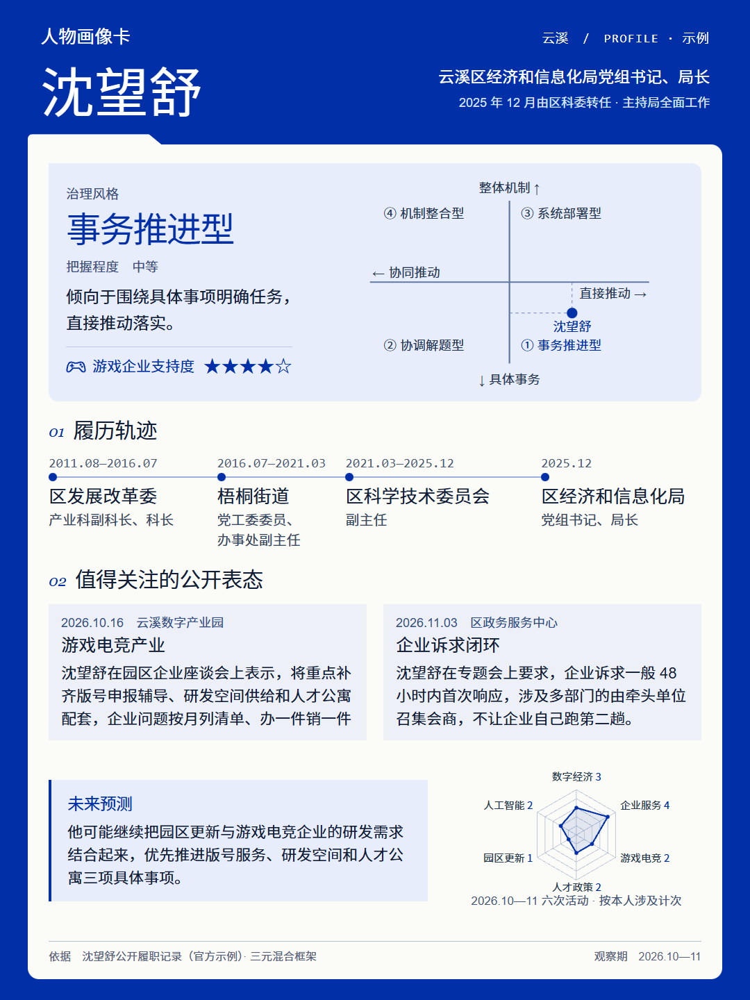

# 人物情报库 · dsh 插件

把「人物资料搜集」和「人物画像卡」两个 skill 做成一个能长期用的工作台：调研过的档案、出过的画像卡都收在侧栏里，随时能查、能改、能接着做下一张。

侧栏入口：**人物情报库**（排在「歸藏设计」后面）。界面沿用歸藏设计那套瑞士风：灰阶底、纸色卡片、直角、1px 细线、等宽小字标签，明暗跟随 dsh。



> 上图是插件自带的官方示例（`examples/`）：人物沈望舒、云溪区均为虚构，链接用 `*.example` 保留域名。

## 快速开始

1. 装完重启 dsh，侧栏点「人物情报库」。
2. **资料搜集** → 选「搜人物 / 搜机构」→ 填姓名、地区、单位，选检索精度 → 「开始搜集」。后台自己跑完并按覆盖度下限校验，不达标的会拒绝入库、列出缺口继续补。
3. **人物画像制作** → 从资料库选人 / 上传资料 / 只输姓名 → 「生成画像卡」，1080×1440 PNG 自动进画像库，点开就能看、能下载。

## 五个页面

| 页面 | 能做什么 |
|---|---|
| **人物资料库** | 集中显示调研过 / 主动上传的人物与机构档案。支持上传 `.md` `.txt`、新建、编辑正文与元信息、删除、按姓名 / 地区 / 单位 / 正文关键字检索；人物档案可一键「做画像卡」。新建档案支持拖入 `.md` / `.txt` / `.docx`：插件读出正文、识别姓名，可以「智能整理并建档」让模型按五章格式整理（`source=user`，不套检索覆盖度门槛），也可以直接保存原文。 |
| **人物画像库** | 一行两张的微缩图墙，点开放大（Esc 关闭），支持上传外部做的卡、删除。每张卡有「下载」按钮（保存 PNG）和「打开文件夹」（在系统文件管理器里定位源文件）。画像制作生成的卡会自动出现在这里。 |
| **资料搜集** | 选「搜人物」或「搜机构」：搜人物填姓名 / 地区 / 单位；搜机构只填机构名称。再选检索精度（粗略 / 全面），点「开始搜集」直接在后台跑，不用跳对话、不用手动发送。搜机构会先写机构概况，再为主要人物逐人建档。 |
| **画像制作** | 三种资料来源：从资料库选人 / 上传或粘贴资料 / 只输姓名。资料库选人默认只显示最近 6 位，可「展开全部 / 收起」，选中的人始终留在列表顶部；资料多了不会把页面撑得很长。上传资料模式不用填任何人物信息，姓名和职务由模型从资料里识别。点「生成画像卡」同样在后台跑，完成后自动入库并弹出预览。 |
| **官方示例** | 两份脱敏示例：一份完整人物档案、一张 1080×1440 画像卡。可打开看细节、可「做同款」跳到对应工作台并预填检索框架。示例人物与链接均为虚构。 |

**层级怎么归类**：统一成 `省级 / 地市级 / 区县级 / 其他`，按**干部级别**而不是行政区划序列——直辖市本级 = 省级；直辖市下辖区 / 县是正厅级，归 **地市级**（北京市朝阳区 = 地市级，北京市级 = 省级）；副省级市（深圳、广州等）的区是副厅级，也归地市级；苏州市级 = 地市级；普通地级市的市辖区 / 县 / 县级市 = 区县级。资料库的筛选按钮、档案编辑器和模型工具都按这套口径，旧数据里的「市级 / 区级 / 厅局级 / 县处级」在读取或保存时会自动归一。

**卡面右上角**统一写「地区 / PROFILE」，**不写编号**；旧样例里的 `PROFILE 001` 已废弃。

**新建档案的智能整理**：`.docx` 由 Host 用 dsh 自带的 Python（python-docx）抽正文和表格；`.md` / `.txt` 由页面直接读。点「智能整理并建档」会走后台 agent，把材料按五章格式整理后调用 `character_profile_save_dossier`，保存时 `source=user`（材料由用户提供，跳过调研覆盖度门槛），origin 记为「上传」。

## 它是怎么跑起来的

点「开始搜集」「生成画像卡」之后，插件会在 **Host 进程里直接起一个后台 agent**（和 dsh headless runner 同一条路：`agents.create()` → `followup(prompt)` → 等 idle），所以你不用跳对话、也不用再点发送：

1. 页面把表单变成一份**任务 prompt**（检索矩阵、覆盖度下限、保存要求都在里面），`POST /api/jobs` 交给后台执行器。
2. 执行器**用当前默认 agent preset**（一般是 `standard`）开一个独立会话的 agent，并在 `setup` 回调里调用 `agentPresets.mount(agentCtx, id)` 把 preset 的插件树挂到 agent 上。这一步很关键：`web_search` / `web_fetch` / `fs` / `bash` / `skill` 这些核心工具挂在 preset 的子插件里，不在根上；只写 `meta.agentPreset` 只记录会话头，不会挂载插件，agent 仍然只能看到 B站、人物库、IM 这类根级插件工具。任务面板会显示 `preset standard`，方便核对。
3. 页面每 2 秒查一次 `/api/jobs`，显示进行到第几步、在调什么工具，并给一个**粗略进度条**：以时间为主的饱和曲线 + 少量步数，前期很慢、越往后越慢（调研约 10 分钟时约 67%，20 分钟约 88%），不会一分钟就 50%、也不会提前卡在 90% 以上；结束才到 100%。可以随时取消。
4. 模型按 skill 规范干活，完成后调用插件注册的工具把成果写回本机：
   - `character_profile_save_dossier` — 存整份人物 / 机构档案；保存前按覆盖度下限检查，不达标会拒绝并列出缺口
   - `character_profile_save_card` — 传 HTML，插件在 Host 进程里用浏览器渲染成 1080×1440 PNG 再入库（模型不需要自己截图）
   - `character_profile_read_dossier` — 做卡前先读资料库里的档案
   - `character_profile_library` — 看两个库里都有什么
   - `character_profile_yuanbao_search` — 用元宝搜索（so.qq.com）搜公开网页 / 公众号 / 媒体结果；公众号卡片带正文片段，能绕开 mp.weixin 验证页，但引用前要用官方同源版本核对
   - `character_profile_wechat_search` — 用搜狗微信搜公众号文章，返回标题 / 摘要 / 发布时间 / 公众号名 / 跳转链接；只作线索，正文仍找同源官方版本（见下）
5. 任务结束时页面自动刷新资料库：有新卡就弹预览并提示「已存到人物画像库」，有档案就提示入库。

后台执行器起不来时（例如宿主没重启、缺 `agents` 服务），页面会**自动退回旧路径**：开一个新对话并把 prompt 填好，你再手动发送。复制 prompt 的按钮一直保留，方便你想自己盯着改。

每个后台任务会留下一个 dsh 会话（标题就是这次任务），方便回溯；它不会抢当前窗口的焦点。

## 覆盖度：资料够不够，入库前先卡一次

只搜姓名、写满五章就交，是资料不全的主要原因。现在做了三层：

1. **检索矩阵**：prompt 和 skill 都列出 10 类检索（姓名+职务、职务反查、单位+年份、姓名+年份、关联条线、名单类、署名文章、公众号、行业协会、site: 站内搜索），每一类都要跑。
2. **入库下限**：全面搜索要求五章齐全、≥2 个任职阶段、≥12 条活动（每阶段 ≥3 条）、≥10 个独立信源（官方域名 ≥3 个）；粗略搜索是 ≥3 条活动、≥3 个信源。
3. **保存时检查**：`character_profile_save_dossier` 会统计章节 / 阶段 / 活动 / 信源 / 官方域名 / 履历行数，不达标返回「未保存 + 缺口清单」，模型必须继续检索补齐再存；确实查不到的，才用 `force: true` 并在 `note` 里说明查过哪些渠道。

资料库每行下面会直接显示 `12 活动 · 10 源 · 3 官方`，机构档案显示 `3 位人物 · 8 活动 · 8 源`，一眼能看出哪份没查够。

**公众号链接（mp.weixin.qq.com）**：微信风控经常返回「环境异常 / 去验证」或 `wappoc_appmsgcaptcha` 页面，这不是文章正文，插件不会反复抓。先用 `character_profile_yuanbao_search`（元宝搜索）搜「姓名 + 地区/职务」「活动名 + 年份」，它会返回公众号、政府、党媒的结果卡片，公众号卡片带正文片段；再用 `character_profile_wechat_search`（搜狗微信）补标题、摘要、发布时间和公众号名。公众号正文来自元宝索引，可能是片段，引用前用区政府 / 区委党校 / 北京组工网 / 北京号 / 区融媒体等可访问的同源版本核对。识别到验证页最多重试 1 次；公众号链接只作线索，找不到同源版本的这条活动不收。

## 内置的两个 skill

`skills/` 下是原样快照，通过 `ctx.skills.registerProvider()` 注册进 dsh，模型在对话里可以直接加载：

- `skills/人物资料搜集/`（注册名 **`person-dossier`**）— 七条硬约束、检索矩阵、按任职阶段逐段检索、双源核验、五章档案格式、覆盖度下限。`references/` 和 `templates/` 都在。dsh 只接受 kebab-case 的 skill 名，所以中文名只作为标题和目录名保留。
- `skills/governance-portrait/` — 议题 / 治理风格 / 分管职责三元框架，两轴四象限编码，克莱因蓝 1080×1440 卡；`assets/layout-example.html` 是版式参照。

加载 skill 正文时会在末尾补一段「在这个插件里怎么交付」，说明用上面六个工具，而不是把文件写到工作区。

## 安装 / 卸载

**用的人只需要一条命令**（装到哪个 profile 就写哪个，桌面版一般是 `desktop`）：

```bash
dsh plugin --profile desktop add dsh-character-profile
```

装完**重启 dsh**，侧栏出现「人物情报库」，模型工具和两个 skill 同时可用。
在 dsh 里也可以走图形界面：侧栏「插件」→「插件商店」→ 搜「人物情报库」→ 安装。

**自己改代码时**用 link 方式，改完重启即生效：

```bash
dsh plugin --profile desktop add D:/dsh画像插件
```

它会在 profile 的 `package.json` 写入 `"dsh-character-profile": "link:D:/dsh画像插件"`、把包名追加进 `dsh.profile.bundles`、并建一个指向本目录的 junction。

卸载：

```bash
dsh plugin --profile desktop remove dsh-character-profile
```

资料不会跟着删，见下。

## 数据在哪

`$DSH_HOME/character-profile/`（一般是 `C:\Users\<你>\.dsh\character-profile`）：

```
dossiers/<id>.json     一份档案：元信息 + 覆盖度 + 完整 Markdown
cards/cards.json       画像卡清单
cards/<id>.png         卡面成品（1080×1440）
cards/<id>.html        生成这张卡时的 HTML（留底，便于改版）
workspace/             后台任务的临时工作目录
```

后台任务的状态（队列、步数、结果 id）只在 Host 进程内存里，重启后清空；成品已经写进上面的库，不会丢。

只写本机，不上传。上传文件走页面里的 FileReader → 同源 JSON 接口，大小限制 24MB。

## 开发

```bash
node scripts/dev-server.mjs     # 本地预览 http://127.0.0.1:4317/character-profile/
node scripts/shoot.mjs          # 五个页面的截图 → .shots/
node scripts/test-ui.mjs        # 点开查看层 / 编辑 / 检索 / 两个工作台 / 示例做同款
node scripts/render-example.mjs # 改完 examples/*.html 后重新渲染示例卡
node scripts/make-icon.mjs      # 重新生成 icon.png
```

预览数据写在 `.devhome/`，不会碰真实的 `~/.dsh/character-profile`。

## 目录

```
├─ package.json          dsh.bundle.patch + dsh.client 声明
├─ cordis.patch.yml      Host 半边入口
├─ lib/
│  ├─ index.js           skill 提供方、六个工具、后台执行器、webServer 路由
│  ├─ client.js          侧栏入口 + iframe + 转发主题 / 开新对话（兜底）
│  ├─ http.js            页面接口（目录、增删改查、上传、示例、后台任务）
│  ├─ store.js           资料库 / 画像库的读写（原子写）
│  ├─ tools.js           六个模型工具（含保存前覆盖度检查、元宝 / 搜狗检索）
│  ├─ yuanbao.js         元宝搜索（so.qq.com）结果卡片解析
│  ├─ wechat.js          搜狗微信检索（公众号标题 / 摘要 / 日期 / 账号）
│  ├─ coverage.js        档案覆盖度统计 + 入库下限
│  ├─ runner.js          进程内后台 agent（一键执行，不跳对话）
│  ├─ render.js          HTML → 1080×1440 PNG（playwright / 本机 Chrome）
│  └─ skills.js          skill 提供方 + 插件环境补充说明
├─ gallery/              插件页面（瑞士风，明暗双色）
├─ skills/               两个 skill 快照
└─ examples/             脱敏示例：档案 md + 卡片 png/html
```
